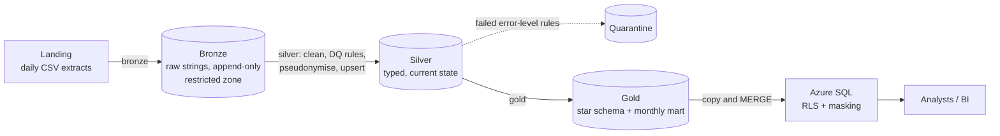

# Health research data platform (portfolio project)

A small but complete data platform for a **synthetic** health-research domain: daily extracts land as files,
move through bronze, silver and gold layers with data quality and privacy controls, end in a Kimball star
schema served from SQL with row-level security and masking, and are deployed and operated as code.

It exists to show *how I build and run* a regulated-data platform: incremental and idempotent loads, quarantine
instead of silent drops, pseudonymisation before data leaves the restricted zone, one definition of every measure,
infrastructure in Terraform behind an approval gate, and runbooks for the day something breaks. The code is
small enough to read in an afternoon.

> **All data is generated.** No real person, patient, employer, client or organisation is represented, and
> nothing in this repository comes from any employer's systems, code, schemas or documents. Identifiers,
> names, postcodes and the "study application" domain are invented for the demonstration.

**Status, stated plainly.** The Python pipeline is run and tested end to end. The SQL, Terraform, GitHub
Actions, Databricks and Fabric parts are written to be correct but have *not* been run against the real
services (no Azure subscription, SQL Server or Databricks workspace was used). The
[verification table](#what-was-verified-and-what-was-not) lists exactly what was checked for each part.

## Architecture



More detail, design decisions and what each layer guarantees: [`docs/architecture.md`](docs/architecture.md).

## Quick start

Needs Python 3.10+ and Java 17+ (Spark runs locally; no cluster, no cloud account).

```bash
python -m venv .venv && source .venv/bin/activate
make setup          # pip install -e ".[dev]"
make demo           # day 1: full load. Day 2: incremental load on top. Prints a run summary for each
make test           # unit tests plus the end-to-end test
make check          # lint, T-SQL lint, Terraform static checks and tests (CI also runs `terraform fmt`/`validate`,
                    # a secret scan and a second Python/Spark combination)
```

`make help` lists the other targets. Output goes to `data/lake/` (git-ignored). By default the pipeline writes
Parquet so it runs anywhere; set `HDP_FORMAT=delta` (with `pip install -e ".[delta]"`) for Delta tables.

## What it does, with real numbers

These come from `make demo` on a two-core virtual machine, using the generator's default volumes.

| | Day 1: full load | Day 2: incremental |
|---|---:|---:|
| Rows read from landing into bronze | 233,654 | 9,243 (**4.0%** of day 1) |
| Silver rows after de-duplication and quarantine | 228,893 | 9,242 |
| Rows quarantined | 3,232 | 1 |
| Gold fact rows upserted (changed rows only) | 167,484 | 8,499 (5.1%) |

After both days: 20,095 applications, 150,788 enrolments and 59,881 participants in silver; the gold facts match
silver exactly; 3,233 rows are in quarantine, each with the names of the rules it broke.

- **Incremental and idempotent.** The second run did about 4% of the row-work of the first. Re-running with
  nothing new changes nothing, and a deliberately stale record does not overwrite a newer one (both are
  asserted in the end-to-end test).
- **Quarantine, not silent drops.** Examples from the run: `participant_exists` (582 enrolments referencing an
  unknown participant), `decision_date_plausible` (100 applications with a decision before submission),
  `identifier_valid` (229 malformed participant references).
- **History kept where it matters.** A site renamed on 2025-06-02 became two versions in `dim_site`
  (`valid_from`/`valid_to`, with `is_current`), and a test checks that *every* fact points at the version valid
  on its own date.
- **Privacy by design.** Silver and gold hold a salted-hash pseudonym instead of the participant reference, a
  birth year instead of a date of birth, and an outward postcode instead of a full one. A test asserts that no
  raw identifier column exists downstream.

**Run time fell only about 20%** (sum of per-stage timings, which exclude process and session start-up: 72.5 s to 58.0 s).
The dimensions and the mart are rebuilt on every run, there is a fixed warm-up cost on the first Spark job, and the local
Parquet fallback rewrites a whole table on every upsert, which Delta's `MERGE` does not. See
[`docs/cost-and-capacity.md`](docs/cost-and-capacity.md) for what this does and does not say about cost.

## Repository tour

| Path | What is in it |
|---|---|
| `src/hdp/` | The pipeline: `generate` (synthetic data with realistic faults), `bronze`, `silver`, `gold`, `dq` (rules and quarantine), `privacy`, `measures` (every metric defined once), `lake` (watermarks, upserts), `observability` (structured run log) |
| `tests/` | 60 tests (58 run by default, 2 opt-in Delta tests), including an end-to-end run across two days, a rerun, a stale record, and recovery after a partial run |
| `sql/ddl`, `sql/procs` | Star schema with columnstore facts; Two representative `MERGE` procedures with `TRY/CATCH` and a load log (type 2 `dim_site`, `fact_enrolment`) plus a log-purge procedure. Staging and merge exist for those two tables only; the other tables would follow the same patterns |
| `sql/security` | Row-level security (region filter) and dynamic data masking |
| `sql/ops` | DBA scripts: index and columnstore health, statistics, Query Store, blocking and waits, capacity, missing indexes |
| `sql/tests` | Reconciliation checks, and checks that impersonate users to prove RLS and masking work |
| `infra/terraform` | Lake, Key Vault, Azure SQL, Data Factory identity, Log Analytics, alert rules, budget; dev, test and prod variable files. See its [README](infra/terraform/README.md) |
| `.github/workflows` | CI (lint, tests on two Python and Spark combinations, T-SQL lint, Terraform checks, secret scan) and a deploy workflow: plan, reviewer approval, apply the saved plan (dev applies on merge without approval; test and prod wait for a reviewer, in that order) |
| `monitoring/kql` | Log Analytics queries: failed run, silent failure, SQL contention, cost, audit |
| `databricks.yml`, `notebooks/` | A Databricks Asset Bundle and a Fabric/Databricks notebook wrapper (templates) |
| `docs/` | [Architecture](docs/architecture.md), [data model](docs/data-model.md), [security and governance](docs/security-and-governance.md), [operations runbook](docs/operations-runbook.md), [cost and capacity](docs/cost-and-capacity.md), [skills map](docs/cv-skills-map.md) |

## Design decisions worth a look

- **Idempotent and self-healing.** Bronze is at-least-once; silver and the facts are upserts where the latest
  `updated_at` wins, and gold selects the rows it has not yet caught up with by comparing against what it already holds
  (not by run id). So running the pipeline again is the recovery for a run that stopped part-way, which is what you
  want at 3am. A test stops the pipeline after bronze and after silver and checks gold catches up.
- **Quarantine with reasons.** A bad row neither disappears nor stops the run. Quarantine volume is logged, so
  a sudden jump is visible as an upstream change rather than discovered in a report.
- **Pseudonymise early, and be honest about it.** The privacy documentation says what each technique does
  *not* do: a pseudonym is still personal data, a ten-digit identifier is trivially reversible without a
  secret salt, and masking is not an access boundary.
- **Measures defined once.** "Decided", "approved", "days to decision", "met target" and age band live in one module that
  the facts use; the mart aggregates those columns, so there is one definition, not five.
- **Deterministic surrogate keys.** Hashes of business keys, so the lake and the SQL layer agree with no lookup
  tables to keep in sync.
- **Approval after the plan.** The deploy workflow separates plan, approve and apply, so a reviewer reads the
  plan before approving and the applied change is exactly the reviewed one.

## What was verified, and what was not

| Part | What was done | What was *not* done |
|---|---|---|
| Python pipeline and tests | 58 tests passing (2 opt-in Delta tests skipped) on Spark 4.2 (Python 3.12) and Spark 3.5.9 (Python 3.11); `ruff check` and `ruff format` clean; full-volume `make demo` | Not run on a cluster, Fabric or Databricks; no performance benchmark |
| Delta Lake path | The `MERGE` branch is written and an opt-in test exists (`HDP_TEST_DELTA=1`) | Not run here |
| T-SQL | Parsed and linted with sqlfluff's T-SQL dialect (two files it cannot parse are excluded, and listed in `.sqlfluffignore`) | **Never executed on SQL Server or Azure SQL.** Procedures, RLS and masking are untested |
| Terraform | Every file parses; variables, references and `file()` targets cross-checked by `scripts/check_terraform_static.py` | `terraform fmt`, `validate` and `plan` were **not run** (no binary available). CI runs `fmt` and `validate`; `plan` runs in the deploy workflow, which needs Azure |
| GitHub Actions | YAML parsed and job structure checked | Workflows have never run on GitHub |
| Databricks bundle, Fabric notebook | Written as templates | Not validated against a workspace |
| Monitoring (KQL and alert rules) | Written | Not deployed; queries not run against real logs |

## Known limitations

- A quarantined row whose parent arrives *later* (for example an enrolment before its participant) is not
  replayed automatically. Replay is the first thing I would add.
- Batch only. No streaming, no Event Hubs.
- No orchestrator definitions (Data Factory or Fabric pipeline JSON), private endpoints, data catalogue or lineage
  (Purview, Unity Catalog), or folder-level ACLs in the lake.
- UK GDPR is addressed as *technical controls on synthetic data*, not as compliance. Retention and erasure
  workflows, subject rights handling and a data protection impact assessment are out of scope.
- Environment sizes, budgets and service levels are illustrative placeholders, not derived from a real workload.

## Licence

No licence has been chosen yet, so all rights are reserved until one is added. Synthetic data only; no warranty.
