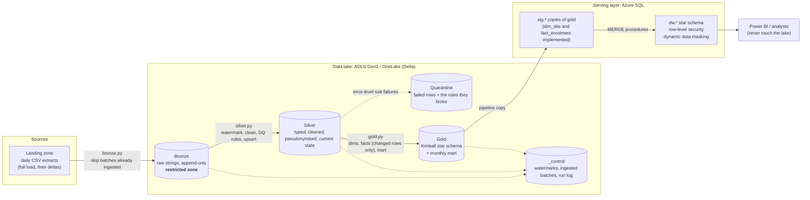

# Architecture

A medallion-style data platform for a synthetic "research study applications" domain: applications to
review studies, the studies themselves, the sites that run them, and the participants enrolled. All data
is generated; the design mirrors how a regulated health-data platform is usually built.

## Flow

Orchestration (Data Factory or a Fabric pipeline) triggers the notebook or wheel, then the copy and merge
steps. Its run history, plus resource logs from the lake, Key Vault and SQL, flow to Log Analytics, where
three alert rules watch for failure, silence and contention (see `monitoring/` and `operations-runbook.md`).

## Layers and what each one guarantees

| Layer | Contents | Guarantee | Intended readers (enforced at container level only) |
|---|---|---|---|
| Landing | Files exactly as delivered | Nothing is modified | Pipeline identity, platform engineers |
| Bronze | Raw values as strings plus audit columns (`_batch_date`, `_run_id`, `_source_file`, `_ingested_at`) | Append-only, replayable. With landing, the **only** place raw identifiers exist | Pipeline identity, platform engineers |
| Silver | Typed, standardised, de-duplicated current state | One row per business key; no raw identifiers, no date of birth, no full postcode | Pipeline identity, platform engineers |
| Quarantine | Rows that failed an error-level rule, as JSON, with `failed_rules` | Nothing is silently dropped | Platform engineers |
| Gold | Star schema and the monthly mart | Conformed dimensions, unknown-member rows, deterministic keys | Pipeline identity, platform engineers |
| Serving (SQL) | Same star schema | Row-level security by region, masked participant columns | Analysts, via roles |

## Design decisions

**Quarantine instead of dropping or failing.** A bad row should neither disappear nor take the whole run
down. Rules have a severity: `error` rows are quarantined with the names of the rules they broke;
`warning` rows load with the rule recorded in `dq_warnings`. Quarantine volume per run is logged, so a
spike (an upstream change) is visible straight away.

**Incremental by watermark, idempotent where it matters.** Silver reads only bronze rows newer than the
per-entity watermark. Silver and the fact tables are upserts where the row with the latest `updated_at` wins,
so re-running a batch, delivering a batch twice, or receiving a stale record cannot corrupt anything. Bronze
delivery is at-least-once; everything after it tolerates that. Gold decides what to load by comparing silver
with what gold already holds (a missing key or a newer `updated_at`), not by run id, so a run that stopped
after bronze or silver is recovered by simply running again. The dimensions and the mart are rebuilt each
run, and quarantine is append-only: a full refresh, or a crash between the quarantine write and the watermark
update, can append the same failing row twice, so report on distinct rows. The tests prove the rest: a rerun
with nothing new changes nothing, a stale record does not overwrite newer data, and gold catches up after
bronze-only and silver-only runs.

**Pseudonymise before the data leaves bronze.** The participant identifier becomes a salted SHA-256 hash in
the silver cleaning step; date of birth becomes a birth year; a postcode becomes its outward code. The
quarantine payload is built from the cleaned columns, so quarantined rows do not leak raw values either.
See `security-and-governance.md` for what this does and does not protect against.

**Deterministic surrogate keys.** Keys are hashes of the business key (and, for the type 2 site dimension,
its `valid_from`). No sequence generator, no key lookup tables to keep in sync, and the lake and SQL layer
agree on keys without coordination.

**Type 2 history for sites, with half-open intervals.** A renamed site gets a new version
(`valid_from <= date < valid_to`). Facts resolve to the version that was current on the fact's date, so
last year's applications keep last year's site name. Tests check this against every fact row.

**Measures are defined once.** `src/hdp/measures.py` defines "decided", "approved", "days to decision",
"met target" and age bands, and the facts use those functions. The mart only sums and averages the resulting
columns (its percentage is a simple ratio of two of those sums), and the SQL layer loads the results without
redefining anything. That is how multiple teams end up with one number.

**Analysts never touch the lake.** They query the SQL serving layer, where row-level security and masking
apply. That keeps the lake's access model small: engineers and the pipeline identity, nobody else.

**Delta first, Parquet fallback.** Delta is the intended format (Fabric and Databricks default to it).
`HDP_FORMAT=parquet` exists so the whole pipeline runs and is tested on a laptop with no jars. The fallback
replaces tables by swapping directories on a local filesystem, so it is local-only by design: it raises
`NotImplementedError` the first time a table has to be replaced on a cloud path (not at start-up).

## What this deliberately does not include

- **Streaming.** Everything here is daily batch. Event Hubs and Structured Streaming are not demonstrated.
- **Orchestrator definitions.** There is no Data Factory pipeline JSON or Fabric pipeline export; the
  notebook wrapper and the Databricks bundle show how the code is started.
- **Private networking.** Terraform sets firewalls to deny by default in test and prod, but private
  endpoints, DNS and a self-hosted build agent are environment-specific and not included.
- **Data catalogue and lineage.** Purview or Unity Catalog registration is not set up here.
- **Fabric items as code.** Lakehouses and notebooks in Fabric are not managed by the `azurerm` provider
  used here; the Fabric Terraform provider would be the next step.
