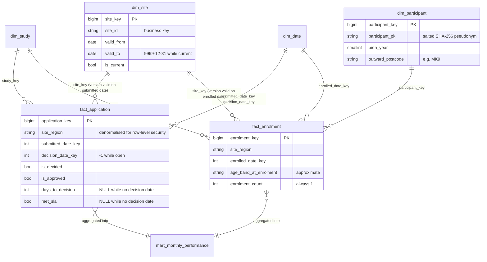

# Data model

## Star schema

## Grain

| Table | One row per | Notes |
|---|---|---|
| `fact_application` | application (latest known state) | Updated in place as the status changes; only rows changed in a run are rewritten |
| `fact_enrolment` | enrolment (latest known state) | Same incremental pattern |
| `mart_monthly_performance` | study x region x month | Applications are attributed to the *lead site's* region and enrolments to the *enrolling site's* region, so a row can mix the two |
| `dim_study` | study | Type 1: a retitled study overwrites |
| `dim_site` | site **version** | Type 2: a renamed site adds a version |
| `dim_participant` | pseudonymised participant | Type 1 |
| `dim_date` | calendar day | Includes the UK financial year (April to March) |

Every dimension carries an unknown member (`-1`). A fact that cannot resolve a key points at it instead of
dangling, and the tests assert that no fact in the generated data resolves to an unknown study, site or participant. (`decision_date_key = -1` is expected, and common: it is the open and withdrawn applications.) so an unknown member showing up
in real data means an upstream reference problem.

## Measure definitions

Row-level measures are defined once in `src/hdp/measures.py`; consumers do not re-implement them. The mart's `pct_decided_within_target` is a ratio of two sums computed in `gold.py`.

A decision date is only *required* when the status is decided (`Approved`/`Rejected`); the data quality rules do not forbid one on other statuses, so these measures key on the decision date rather than the status. The generator never produces one on an open or withdrawn application.

| Measure | Definition |
|---|---|
| `is_decided` | status is `Approved` or `Rejected` (a withdrawn application is closed but not decided) |
| `is_approved` | status is `Approved` |
| `days_to_decision` | `decision_date - submitted_date`; NULL while there is no decision date |
| `met_sla` | `days_to_decision <= HDP_SLA_DAYS` (default 60, an assumption for this demo, not a statement about any real target); NULL while there is no decision date, so "not yet" is never counted as "missed" |
| `pct_decided_within_target` | `decided_within_target / applications_decided * 100` |
| `age_band_at_enrolment` | band of `year(enrolled_date) - birth_year`, so it is approximate by up to a year |

## Source entities (landing CSVs)

| File | Key | Behaviour across days |
|---|---|---|
| `sites.csv` | `site_id` | Full snapshot each day; renamed sites become new dimension versions |
| `studies.csv` | `study_id` | Changed and new rows only |
| `applications.csv` | `application_id` | Changed and new rows; status moves `Submitted` -> `In Review` -> `Approved`/`Rejected`/`Withdrawn` |
| `participants.csv` | `participant_ref` (raw) | New rows only; raw reference is replaced by a pseudonym in silver |
| `enrolments.csv` | `enrolment_id` | Changed and new rows |

## Data quality rules

Error-level rules quarantine the row; warning-level rules load it and record the rule in `dq_warnings`.
The full list is in `src/hdp/silver.py` (`rules_for`). Highlights:

- Identifier formats (`APP000001`, `S00001`, `SITE001`, `ENR0000001`, ten-digit participant reference).
- Referential integrity: an application's study and site, and an enrolment's participant, study and site,
  must already exist in silver. A row referencing something unknown is quarantined, not loaded dangling.
- Dates: parseable, not in the future relative to the batch date, and a decision cannot precede submission.
- A decided status (`Approved`/`Rejected`) must have a decision date.
- Warnings: unrecognised trust type or ethnicity value, malformed postcode (the outward code is NULL).

A row that references a parent which arrives *later* is quarantined and is not replayed automatically.
Replaying quarantine once the parent exists is a known gap, listed in the README.
